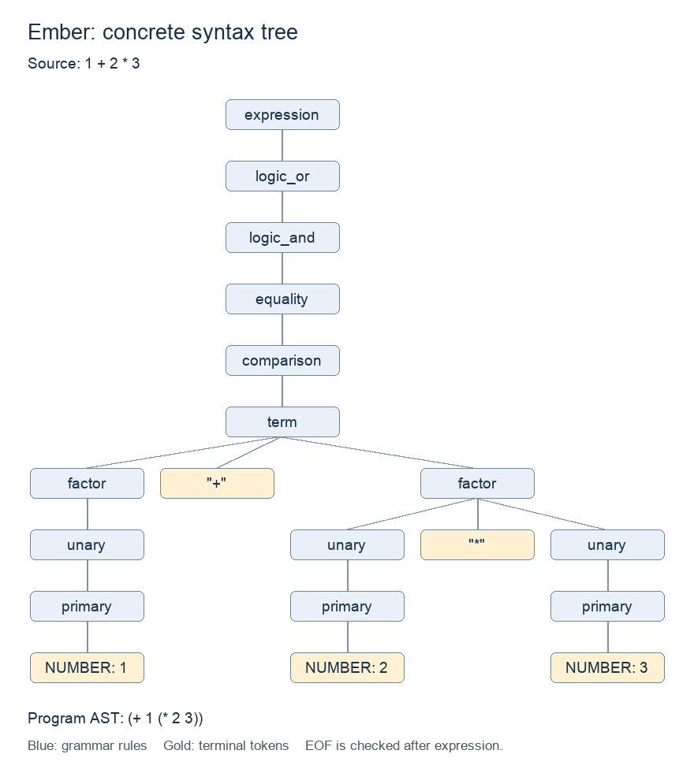

# Lab 3: Ember parser

## Scope and design

Ember now reads one expression, scans it into tokens, parses the tokens into an
AST, and prints the tree. It reuses the Lab 1 scanner and tokens and the Lab 2
expression classes and AST printer. It does not evaluate the expression.

The parser uses recursive descent. Each precedence level has a method, and each
method calls the next higher level to read its operands. Binary operators use
loops that build a new node around the previous result, giving left associativity.
Unary operators recurse on their right operand. Parentheses recursively parse
a complete expression and create a `Grouping` node.

This follows the approach in Robert Nystrom's
[Crafting Interpreters, Chapter 6](https://craftinginterpreters.com/parsing-expressions.html).
Ember differs from the chapter's basic expression subset by retaining `%`,
`and`, and `or` from its Lab 2 grammar and spelling the null literal `null`.
Logical operators are stored as `Binary` nodes. There is no evaluation or
short-circuit behavior yet. The printer continues to quote strings and escape
their contents so string values are distinguishable from other literals.

## Grammar, precedence, and associativity

The expression grammar is **unchanged from Lab 2**. The entry point additionally
requires EOF immediately after the expression, which prevents ignoring trailing
tokens. The notation below uses quoted terminals, uppercase token categories,
`|` for alternatives, `*` for repetition, and parentheses for grammar grouping.

```text
input       -> expression EOF ;
expression  -> logic_or ;
logic_or    -> logic_and ( "or" logic_and )* ;
logic_and   -> equality ( "and" equality )* ;
equality    -> comparison ( ( "==" | "!=" ) comparison )* ;
comparison  -> term ( ( "<" | "<=" | ">" | ">=" ) term )* ;
term        -> factor ( ( "+" | "-" ) factor )* ;
factor      -> unary ( ( "*" | "/" | "%" ) unary )* ;
unary       -> ( "!" | "-" ) unary | primary ;
primary     -> NUMBER | STRING | "true" | "false" | "null"
             | "(" expression ")" ;
```

| Precedence, lowest first | Operators / form | Associativity |
| --- | --- | --- |
| 1 | `or` | Left |
| 2 | `and` | Left |
| 3 | `==`, `!=` | Left |
| 4 | `<`, `<=`, `>`, `>=` | Left |
| 5 | `+`, `-` | Left |
| 6 | `*`, `/`, `%` | Left |
| 7 | Unary `!`, unary `-` | Right |
| 8 | Literals and parenthesized expressions | Primary |

For example, `1+2*3` becomes `(+ 1 (* 2 3))`, while `(1+2)*3` becomes
`(* (group (+ 1 2)) 3)`. `8-3+1` becomes `(+ (- 8 3) 1)`, and `!- -2`
becomes `(! (- (- 2)))`.

Numbers and strings use the scanner's literal values. The keywords `true`,
`false`, and `null` become `Literal(True)`, `Literal(False)`, and `Literal(None)`.
Numbers remain floats internally; the printer removes redundant `.0` suffixes.
Strings retain Lab 1's five escapes and Unicode content. Comments and whitespace
are discarded by the scanner before parsing.

Identifiers, declarations, assignment, calls, lists, comma expressions, and
ternary expressions are outside this grammar. There is no semicolon terminator:
`1;` is rejected at `;`. A file may contain multiple physical lines, but they
must form exactly one expression. Each interactive line is one independent
submission. Empty or comment-only input is an error because it contains no expression.

## Implementation and integration

| Component | Role |
| --- | --- |
| `src/scanner.py`, `src/tokens.py` | Reused lexical analysis and token storage |
| `src/expr.py` | Reused Literal, Unary, Binary, and Grouping classes |
| `src/ast_printer.py` | Reused parenthesized prefix printer |
| `src/parser.py` | New Parser and ParseError classes |
| `src/main.py` | File/prompt entry point connecting the three stages |

`Parser(tokens).parse()` expects a list produced by the scanner, including its
final EOF token. It returns the existing expression objects, not a preformatted
string. The field test checks that operands, operator tokens, and grouping are
actually stored in those classes. A Parser instance is used for one submission.

The main program scans the entire source first. If there are lexical errors,
it prints those diagnostics and stops processing that submission. Otherwise,
it parses and formats the AST. It builds the entire output string before printing,
so a parse or printing-depth failure cannot leave partial AST output.

File and interactive modes use the same `Ember.run()` method. Each interactive
line creates a fresh scanner and parser, so an invalid input does not poison
the next input. The prompt ends on EOF or Ctrl-C while waiting for input.

The new default output is an AST. `--tokens` retains Lab 1's scanner-only mode,
including printing recovered tokens on lexical errors. That legacy option does
not parse or print an AST. The Lab 1 test scripts now request it explicitly;
their expected token results are unchanged apart from the updated usage message.

## Error handling

The parser stops at the first syntax error in a submission and raises a
`ParseError` containing the problem, line, and offending lexeme or `at end`.
The entry point displays that message on stderr and prints no AST on stdout.
The scanner may report multiple lexical errors, which also prevent parsing.

| Diagnostic | Example / cause | Location |
| --- | --- | --- |
| Expected an expression | `1+`, `-`, `()`, `count`, or `)` lacks an allowed operand where one is required | Current token or EOF and line |
| Expected `)` after expression | `(1+2` leaves a group open; `(1 2)` puts another operand where `)` is needed | Current token/EOF line, plus opening line |
| Unexpected trailing token | `1 2`, `1)`, `1;`, or `1=2` leaves tokens after a complete expression | First trailing token and line |
| Missing left operand | `* 2` or `1 + * 2` places a binary-only operator where an operand must start | Operator and line |
| Expression is too deeply nested | Excessive parenthesis/unary nesting exceeds Python's recursion limit | Current parser token's line |
| Expression tree is too deep to print | A very long left-associated chain creates a tree beyond the recursive printer's limit | First token's line |

The depth limits are runtime-dependent, so the program reports a controlled
error instead of promising a fixed maximum nesting depth. The tests use 2,000
levels/operators, comfortably beyond the normal Python limit, and check recovery.
No recursion limit is raised by the application.

For example, `1+` reports:

```text
[line 1] Error at end: Expected an expression.
```

`1 @ + 2` reports a lexical error without parsing the otherwise recoverable tokens:

```text
[line 1] Error: Unexpected character '@'.
```

## Setup and commands

Use Python 3.10 or newer; no third-party packages are required to run the program
or tests. Run commands from the repository root, containing `src/`, `test/`, and
`report/`. The pre-rendered diagram is included and does not need regeneration.

```sh
# Parse the committed example file.
python3 src/main.py test/lab3/example.ember

# Start the expression prompt.
python3 src/main.py

# Run all portable Lab 3 checks and regenerate the detailed results.
python3 test/lab3/run_tests.py --report

# Additional real-terminal checks on macOS/Linux.
python3 test/lab3/terminal_test.py --report

# Reproduce earlier labs against the reused components.
python3 test/lab1/run_tests.py --report
python3 test/lab1/terminal_test.py --report
python3 test/lab2/run_tests.py --report

# Scanner-only file mode from Lab 1.
python3 src/main.py --tokens test/lab1/inputs/example.ember
```

In interactive mode, type `1 + 2 * 3` and press Enter to see `(+ 1 (* 2 3))`.
Ctrl-D at an empty prompt exits on macOS/Linux; Ctrl-Z then Enter supplies EOF
on a standard Windows console. Ctrl-C while waiting also exits.

Exit statuses remain 0 for success, 65 for lexical/syntax/depth errors in a file,
66 for file reading/UTF-8 errors, and 64 for incorrect arguments. Interactive
mode keeps running after errors and returns 0 when the session ends normally.
Tokens, ASTs, and prompts go to stdout; diagnostics go to stderr.

## Concrete syntax tree and printed AST

The source expression is `1 + 2 * 3`. The following **concrete syntax tree**
starts at `expression` and includes every nonterminal level down to the NUMBER
tokens. The outer `input` rule also checks EOF after this expression; EOF is a
scanner boundary rather than a source character and is not drawn as part of
the expression subtree.



Reading the terminal leaves from left to right gives `1`, `+`, `2`, `*`, `3`.
The `term` node expands to `factor "+" factor`. Its right factor expands to
`unary "*" unary`, while each numeric operand passes through `unary` and
`primary` to NUMBER. The upper rules have no operators for this expression and
each passes through to its single child. Thus the diagram follows the grammar
without omitting precedence levels.

The actual output from `python3 src/main.py test/lab3/example.ember` is:

```text
(+ 1 (* 2 3))
```

The AST removes grammar-only wrapper nodes. It keeps a Binary `+` at the root,
Literal `1` on the left, and Binary `*` with Literal `2` and Literal `3` on the
right. The multiplication subtree is therefore the right operand of addition,
which is exactly the grouping implied by the concrete tree.

## Tests and actual results

**172/172 portable Lab 3 checks and 2/2 terminal checks passed.** Regression runs
also passed all 85 portable and 2 terminal Lab 1 checks, and all 37 Lab 2 checks.
That is **298 passing checks** across the three labs.

The following result files form part of this report:

- [Lab 3 source, parser, and CLI results](lab3-results.md): every test's purpose,
  exact source input, expected stdout/stderr/status, actual output, and match result.
  Invalid cases explain why their source is invalid in the purpose text.
- [Lab 3 terminal results](lab3-terminal-results.md): input actions and expected/
  actual terminal transcripts for error recovery, Ctrl-D, and Ctrl-C.

`test/lab3/cases.py` stores 78 explicit source cases and expected results. Each
runs through the scanner/parser/printer API and through the real main program
using a temporary UTF-8 file, accounting for 156 checks. The runner preserves
the source bytes, including CR, LF, CRLF, and missing final newlines. Keeping
these test inputs in a marked Python file avoids attribution comments changing
line numbers or invalid/EOF cases. The remaining 16 portable checks cover a
combined interactive session, immediate EOF, AST fields, depth failures and
recovery, argument errors, missing/invalid files, paths with spaces, and the
committed example file.

The interactive session includes every single-line case and sends a valid
`2+3` submission immediately after each invalid one. The separate pseudo-terminal
test checks lexical and syntax errors followed by a valid expression, then EOF;
it also checks SIGINT while awaiting input. These terminal tests use Unix APIs;
the portable suite uses ordinary subprocess pipes and files.

All four node classes, all four literal categories, both unary operators, and
all 13 binary operators are covered. Cases exercise every adjacent precedence
level, left associativity at each binary level, right-nested unary operations,
and explicit nested grouping. Error assertions require empty AST stdout, the
expected diagnostic, and the expected exit status rather than merely checking
that an exception occurred.

## Extra-credit request

**Missing left operand diagnostics** are submitted for instructor consideration.
When a binary-only operator is encountered at the start of a primary expression,
the parser reports that operator specifically instead of only saying that an
expression was expected. For example, `* 2` produces:

```text
[line 1] Error at '*': Missing left operand for '*'.
```

The additional check must distinguish binary-only operators from `-`, which
can legitimately begin a unary expression. It also works within an expression,
such as `1 + * 2`. The 12 `missing_left_...` cases cover every binary-only
operator, and `consecutive_binary` covers the internal case. The `negation` and
`unary_chain` cases confirm that valid unary minus is still accepted. All cases
have actual output in the detailed results. Credit is subject to instructor
evaluation and the assignment's overall 10-point extra-credit cap.

## Limitations and attribution

There are no known failing tests. This remains an expression parser and tree
printer, not an evaluator or statement parser. It does not reject semantically
questionable but syntactically valid expressions such as `2/0` or chained
comparisons. It parses one expression per file or interactive line, reports one
syntax error per submission, and does not synchronize within that submission.
Diagnostics identify a line and token rather than a character column. Large
inputs are stored in memory; very deep trees are rejected as described above.
The Parser API assumes complete scanner output ending in EOF.

AI assistance was used for the implementation, tests, reports, and diagram.
Python test files are enclosed by
`# --- start AI code ---` and `# --- end AI code ---`. These use Python's comment
syntax while retaining the required marker wording. The Ember example uses
the requested `//` marker syntax. Earlier submission commits remain unchanged;
these annotations are included in the new Lab 3 commit.

Submit the exact published Lab 3 commit URL on Blackboard, with the repository
accessible to the instructor. That commit includes the earlier components and
reports as well as `test/lab3/`, this report, the result files, and the tree image.
